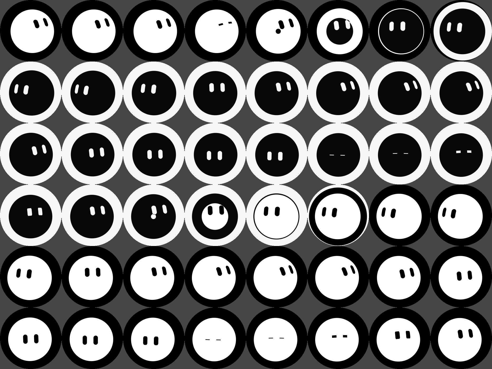
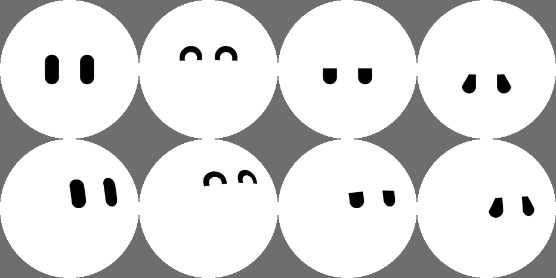

# RoboEyes

Two pill-shaped eyes for the **Waveshare ESP32-S3-Touch-AMOLED-1.43** (466×466 round AMOLED, capacitive touch).

The round screen itself is the character's face. It's rendered as a 3D ball the exact size of the display, so only the eyes are drawn, and they squash and lean naturally as the face looks around.

- **Idle:** white face, black eyes. Both eyes blink together and keep gliding around.
- **Tap:** the eyes look around and the face inverts with a circular wipe: black face, white eyes.
- **Tap again:** back to white (or set `AUTO_RETURN_MS` to go back automatically).



Works with both panel variants Waveshare ships on this board (SH8601 and CO5300). The panel is detected at boot.

## Flashing (Arduino IDE)

1. Install the board package **"esp32 by Espressif Systems"** (v3.1 or newer). No other libraries are needed.
2. Open `RoboEyes.ino`, keeping every file in this folder together.
3. Tools menu:
   | Setting | Value |
   |---|---|
   | Board | ESP32S3 Dev Module |
   | USB CDC On Boot | Enabled |
   | Flash Size | 16MB |
   | PSRAM | OPI PSRAM |
4. Plug in the board and click **Upload**.

### arduino-cli

```sh
arduino-cli compile --upload -p /dev/cu.usbmodem* \
  --fqbn "esp32:esp32:esp32s3:CDCOnBoot=cdc,FlashSize=16M,PSRAM=opi" .
```

## Customizing

Everything you're likely to change is at the top of `RoboEyes.ino`:

| Setting | What it does |
|---|---|
| `IDLE_FACE`, `IDLE_EYES` | Colors before tapping (`0xRRGGBB`) |
| `TAP_FACE`, `TAP_EYES` | Colors after tapping |
| `FACE_RADIUS` | Size of the ball the eyes sit on (236 = fills the screen; bigger = bigger eyes) |
| `HOME_YAW`, `HOME_PITCH`, `HOME_ROLL` | Resting gaze direction (default: up and to the right, like the reference art) |
| `GAZE_WANDER`, `GAZE_DRIFT` | How much the eyes look around / float while idle |
| `GAZE_SPEED` | Eye movement speed (`1.0` default; lower = slower and silkier) |
| `EYE_SPACING`, `EYE_HEIGHT`, `EYE_WIDTH`, `EYE_LENGTH`, `EYE_TILT` | Eye shape and placement |
| `WIPE_MS` | Speed of the white/black inversion |
| `AUTO_RETURN_MS` | `0` = tap toggles; otherwise return to white after N ms |
| `SCREEN_ROTATION` | Turns the picture clockwise: `0`, `90` (default), `180`, `270` |
| `BRIGHTNESS` | `0`–`255` |
| `TARGET_FPS` | Frame-rate cap (default 60) |
| `SHOW_FPS` | `1` = print `D fps …` to the Serial Monitor (115200 baud) every 10 s |
| `FOLLOW_YAW`, `FOLLOW_PITCH` | How far the eyes turn when the website says "look all the way left/right/up/down" |
| `BLE_NAME` | Bluetooth name; keep `EyeBuddy` (the website looks for it) |

### Previewing on a computer

`eyes_render.h` and `eyes_anim.h` are plain C++, so you can preview changes without flashing:

```sh
clang++ -O2 -std=c++17 -o preview extras/preview/preview.cpp
./preview sheet.ppm 1900 3000     # frames every 50 ms, taps at 1.9 s and 3.0 s
```

(The preview uses its own copy of the settings at the top of `preview.cpp`.)

## Website control

The website **https://softobsessing.github.io/doomscroll-eyes/** controls the moods. It watches you through your webcam and connects to the board over **USB** (Connect USB) or **Bluetooth** (Connect Bluetooth → pick `EyeBuddy`).

| Mood (website button) | Eyes |
|---|---|
| focused (`neutral`) | the reference pills |
| welcome back (`happy`) | arches, `^ ^` |
| side-eye (`side`) | flat, half-closed upper lids |
| disappointed (`sad`) | droopy outer corners, head dipped |



_Top: looking straight ahead. Bottom: looking up and to the right._

While connected, the website also sets where the eyes look (they follow you) and when they blink, and the eyelids morph smoothly between moods. A tap on the board still flips the colors, and the website's preview flips too. If the website goes quiet for 3 s, the board goes back to doing its own thing.

The website's live preview (`eyes.js` in the doomscroll-eyes repo) is a line-for-line JavaScript port of `eyes_render.h` + `eyes_anim.h`, so it shows exactly what the board shows. **If you change shapes, moods or timings here, change `eyes.js` too**, then check they still match:

```sh
clang++ -O2 -std=c++17 -o parity extras/parity/parity.cpp && ./parity /tmp/parity_out
cd ../doomscroll-eyes && node test/eyes_port.test.mjs /tmp/parity_out
```

### Protocol (text lines, same over USB serial at 115200 and Bluetooth Nordic UART)

| Direction | Line | Meaning |
|---|---|---|
| website → board | `E <neutral\|happy\|side\|sad> <lookX> <lookY>` | mood + where to look (−100..100, + = right / down), ~20 per second |
| website → board | `B` / `B2` | blink now / double blink |
| website → board | `P` | ping |
| board → website | `HELLO RoboEyes 1` | on boot and in reply to `P` |
| board → website | `T touch` / `T release` | finger down / up |
| board → website | `C light` / `C dark` | current colors (on `HELLO` and whenever a tap flips them) |
| board → website | `D fps <n> draw_ms <n>` | USB only, every 10 s (frame rate; the website ignores it) |

## How it stays smooth

Every frame is generated live, so smoothness comes down to frames per second and how far the eyes move between frames:

- **Only changed pixels are redrawn.** The face is one solid color, so each frame redraws just the area around each eye. During the color switch it adds only the thin ring the wipe circle grew through since the last frame (`eyes_dirty.h`).
- **The 3D math is limited to a tight box around each eye**, traced from the pill's outline.
- **Both CPU cores draw**, and DMA sends one strip to the panel while the next is drawn.
- **Touch is read on a background task**, so it can never delay a frame.
- **Motion eases in and out.** Eye movement goes through two smoothing stages, so speed rises and falls gently, and a new target mid-move blends in without a jerk.

Open the Serial Monitor at 115200 baud to see the live frame rate (close it before connecting the website over USB: only one program can use the port).

## Hardware pins

| Signal | GPIO |
|---|---|
| QSPI CS / CLK | 9 / 10 |
| QSPI D0–D3 | 11, 12, 13, 14 |
| AMOLED reset | 21 |
| AMOLED power enable | 42 |
| Touch SDA / SCL (FT3168 @ 0x38) | 47 / 48 |

## Credits

- `esp_lcd_sh8601.c/.h`: Espressif Systems, Apache-2.0, as bundled in Waveshare's demo package.
- `ble_link.cpp/.h`: from the EyeBuddy firmware in the doomscroll-eyes repo.
- `read_lcd_id_bsp.c/.h`: from Waveshare's [ESP32-S3-Touch-AMOLED-1.43 demo](https://www.waveshare.com/wiki/ESP32-S3-Touch-AMOLED-1.43).
