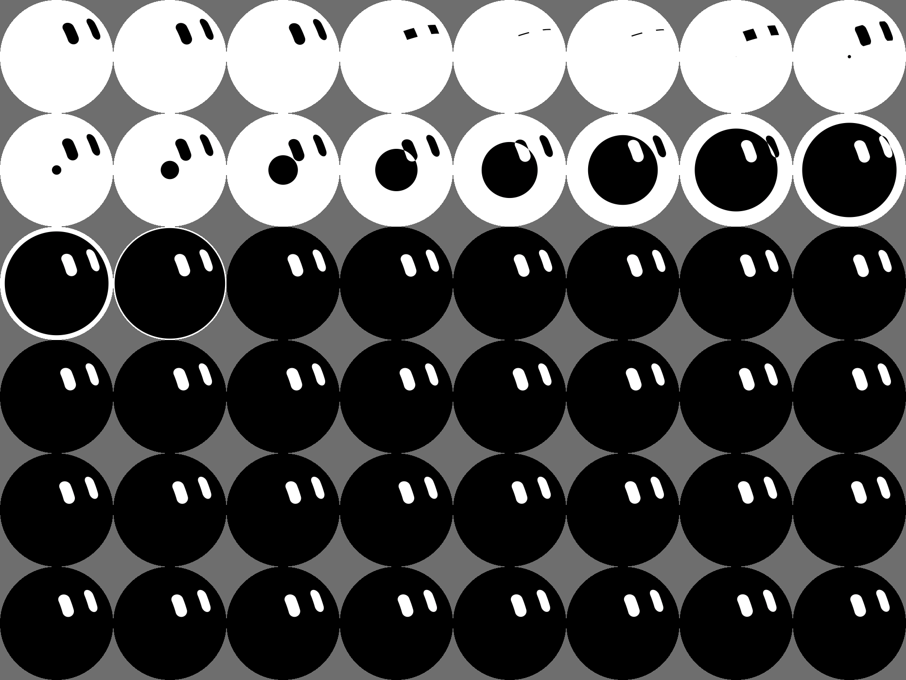
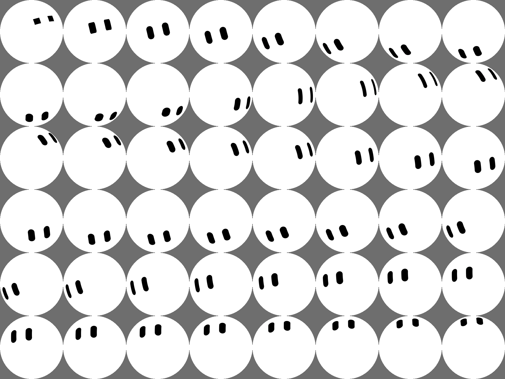
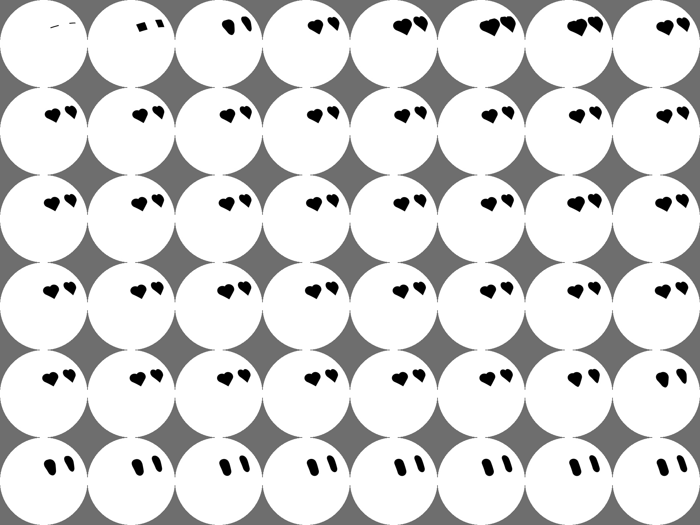
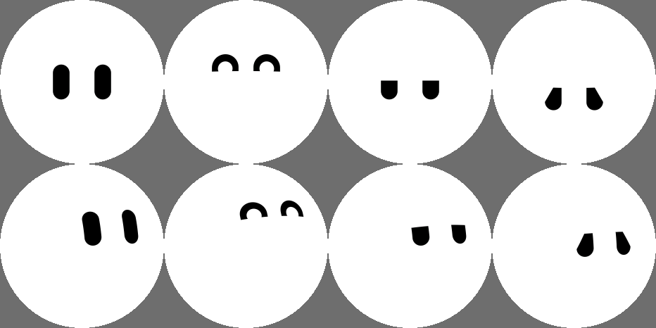

# RoboEyes

Two pill-shaped eyes for the **Waveshare ESP32-S3-Touch-AMOLED-1.43** (466×466 round AMOLED, capacitive touch), plus a web app to color them.

The round screen itself is the character's face. It's rendered as a 3D ball the exact size of the display, so only the eyes are drawn, and they squash and lean naturally as the face looks around.

- **On its own:** white face, black eyes (or your colors). Both eyes blink together and keep gliding around.
- **Touch:** the face and eye colors **swap** with a circular wipe (touch again to swap back). Or switch touch to **eyes follow your finger**: wherever you touch or drag, the eyes glide after it.
- **Moves:** **dart left**, **dart right**, and **shake it**: the eyes bounce all around the screen like a shaken toy, squash against the edge, come to rest, blink, and float home.
- **Heart eyes:** the pills melt into hearts (with a little pop) that beat "lub-dub" until you turn them off. They still blink, glance, dart and bounce.
- **Blink with me:** turn on the camera in the web app and it blinks when you blink. It's extra sensitive by default and has a slider.
- **Web app:** **https://softobsessing.github.io/RoboEyes/** picks the face and eye colors live, saves color pairs, and mirrors touches in a live preview.



_A touch: white face with black eyes → black face with white eyes._

Works with both panel variants Waveshare ships on this board (SH8601 and CO5300). The panel is detected at boot.



_Shake it, every 33 ms: kicked around, squashed flat against the bottom, stretched tall against the side, then settling._



_Heart eyes, every 50 ms: pills melt into hearts, pop, beat, and melt back._

## Repo layout

| Path | What |
|---|---|
| `index.html`, `style.css`, `app.js` | the web app (served by GitHub Pages from the repo root) |
| `roboeyes.js` | line-for-line JavaScript port of the board's eye code, for the live preview |
| `link.js` | USB (Web Serial) and Bluetooth (Web Bluetooth, Nordic UART) link |
| `board.js` | recognizing a RoboEyes board (`HELLO`), color lines |
| `colors.js` | the color wheel + saved colors |
| `vision.js`, `blink.js` | camera + face model, and the blink detector for "Blink with me" |
| `vendor/` | MediaPipe Tasks Vision + its face landmarker model (runs in the browser) |
| `firmware/RoboEyes/` | the Arduino sketch |
| `test/` | `node` tests: protocol, touch behavior, and preview-vs-firmware pixel parity |

## The web app

Open **https://softobsessing.github.io/RoboEyes/** in desktop **Chrome or Edge**. They're the browsers that can talk to USB and Bluetooth.

1. **Connect USB** (plug the board in), or **Connect Bluetooth** and pick `RoboEyes-XXXX`. The page picks up the colors the board is showing.
2. **Colors:** choose **Face** or **Eyes**, then drag on the wheel, use the brightness slider, or type a hex code. The board changes as you drag and remembers the colors after it's switched off. **Save these colors** keeps the pair in this browser. Click a saved face to switch back.
3. **Touch the board:** the colors swap. The page's preview and color picker follow. You can also click the face in the preview to do the same (on the board too, if one is connected).
4. **Touch & moves:** under **When you touch the screen**, pick **Swap colors** or **Eyes follow your finger**. The board remembers it. In follow mode, touch the board and drag: the eyes glide after your finger, stay put for a moment when you let go, then wander home. Dragging on the preview does the same, on the board too. **Dart left** / **Dart right** make a quick glance to that side and back; **Shake it** bounces the eyes all around the screen. **♥ Heart eyes** turns the eyes into beating hearts until you click it again (**Back to normal eyes**). Keyboard shortcuts: ← → S and H. They play on the preview and the board at the same time (the shake uses the same random seed on both, so they bounce the same way).
5. **Blink with me:** click **Turn on camera** and allow the camera. Every time you blink, the preview and the board blink with you. While it's following you, the board skips its own random blinks. They come back 9 s after your last blink. The **eyes closed** meter shows how closed your eyes look; the red line is where it counts as a blink. **Sensitivity** starts at *extra sensitive*, which catches even small, quick blinks. If it blinks when you didn't, slide it left. The camera picture never leaves the computer: the face model (Google's MediaPipe) runs inside the page. The camera turns itself back on next time if you left it on.

After the first time, the page reconnects by itself: USB on page load or when the board is plugged back in, Bluetooth if Chrome allows it. The Bluetooth button remembers your board (`Connect RoboEyes-3F2A`), and **Other board…** picks a different one.

**Each app talks only to its own boards.** The RoboEyes app only drives boards that say `HELLO RoboEyes`. The [doomscroll-eyes app](https://softobsessing.github.io/doomscroll-eyes/) only drives EyeBuddy boards. Both boards use the same USB chip, so if you connect one to the wrong app, the page tells you which app it belongs to, links there, and leaves the port alone. Bluetooth choosers are filtered by name (`RoboEyes-…` vs `EyeBuddy-…`), so the wrong boards never show up there.

### Run it locally

```sh
./serve.sh     # then open http://localhost:8000/ in Chrome
```

(`localhost` counts as a secure context, so USB and Bluetooth work.)

### Publish it (GitHub Pages)

On GitHub: **Settings → Pages → Build and deployment → Deploy from a branch → `main` / `(root)` → Save**. After a minute the app is at `https://softobsessing.github.io/RoboEyes/`. GitHub Pages on a free account needs the repo to be **public**.

## Flashing the firmware

The sketch lives in **`firmware/RoboEyes/`**.

### Arduino IDE

1. Install the board package **"esp32 by Espressif Systems"** (v3.1 or newer). No other libraries are needed.
2. Open `firmware/RoboEyes/RoboEyes.ino`, keeping every file in that folder together.
3. Tools menu:
   | Setting | Value |
   |---|---|
   | Board | ESP32S3 Dev Module |
   | USB CDC On Boot | Enabled |
   | Flash Size | 16MB |
   | PSRAM | OPI PSRAM |
4. Plug in the board and click **Upload**.

### arduino-cli

```sh
cd firmware
arduino-cli compile --upload -p /dev/cu.usbmodem* \
  --fqbn "esp32:esp32:esp32s3:CDCOnBoot=cdc,FlashSize=16M,PSRAM=opi" RoboEyes
```

Close the Arduino Serial Monitor before connecting the web app over USB: only one program can use the port at a time.

## Customizing

Everything you're likely to change is at the top of `firmware/RoboEyes/RoboEyes.ino`:

| Setting | What it does |
|---|---|
| `DEFAULT_FACE`, `DEFAULT_EYES` | Colors until the web app sets others (`0xRRGGBB`) |
| `WIPE_MS` | Speed of the color swap |
| `TOUCH_MODE` | What touch does until the web app picks: `0` swap colors, `1` eyes follow the finger |
| `TOUCH_SWAP_XY`, `TOUCH_FLIP_X`, `TOUCH_FLIP_Y` | If the eyes follow your finger to the wrong spot (mirrored or turned), set these to `1` (swap first, then flip) |
| `FACE_RADIUS` | Size of the ball the eyes sit on (236 = fills the screen; bigger = bigger eyes) |
| `HOME_YAW`, `HOME_PITCH`, `HOME_ROLL` | Resting gaze direction (default: up and to the right, like the reference art) |
| `GAZE_WANDER`, `GAZE_DRIFT` | How much the eyes look around / float while idle |
| `GAZE_SPEED` | Eye movement speed (`1.0` default; lower = slower and silkier) |
| `EYE_SPACING`, `EYE_HEIGHT`, `EYE_WIDTH`, `EYE_LENGTH`, `EYE_TILT` | Eye shape and placement |
| `SCREEN_ROTATION` | Turns the picture clockwise: `0`, `90` (default), `180`, `270` |
| `BRIGHTNESS` | `0`–`255` |
| `TARGET_FPS` | Frame-rate cap (default 60) |
| `SHOW_FPS` | `1` = print `D fps …` to the Serial Monitor (115200 baud) every 10 s |
| `BLE_NAME` | Bluetooth name prefix; keep `RoboEyes` (the web app looks for it) |

How long its own blinks pause after copying yours is `MIRROR_QUIET_MS` in `eyes_anim.h` (and in `roboeyes.js`), 9000 by default.

The moves are tuned at the top of `eyes_anim.h` (same names in `roboeyes.js`): `FOLLOW_OMEGA` (finger follow speed), `FOLLOW_REST_MS` (how long the eyes stay after you let go), `DART_X` / `DART_HOLD_MS`, `SHAKE_KICK_MS` / `SHAKE_KICK_SPEED` (when and how hard it gets shaken), `SHAKE_BOUNCE` (how bouncy the edge is), and `REACH_X` / `REACH_Y` (how close to the edge the eyes may go). Heart eyes: `HEART_K` in `eyes_render.h` (heart size) and `HEARTBEAT_MS` / `HEARTBEAT_LUB` / `HEARTBEAT_DUB` in `eyes_anim.h` (the beat).

If you change shapes, moods, colors or timings in `eyes_anim.h` / `eyes_render.h`, make the same change in `roboeyes.js` and run the tests below, so the web preview keeps matching the board.

### Previewing on a computer

`eyes_render.h` and `eyes_anim.h` are plain C++, so you can preview changes without flashing:

```sh
cd firmware/RoboEyes
clang++ -O2 -std=c++17 -o /tmp/preview extras/preview/preview.cpp
/tmp/preview sheet.ppm 2000                         # frames every 50 ms, a touch at 2.0 s
STEP_MS=100 FIRST_MS=3000 /tmp/preview sheet.ppm 2000   # later and slower
MOVE=shake STEP_MS=33 FIRST_MS=2000 /tmp/preview sheet.ppm 2000   # a move instead of a touch: dartL, dartR, shake, follow, hearts
```

(The preview uses its own copy of the settings at the top of `preview.cpp`.)

## Tests

From the repo root (Node 18+ and clang):

```sh
node test/board.test.mjs     # HELLO parsing, wrong-board detection, color lines
node test/touch.test.mjs     # the touch rule: swap the colors, eyes unchanged, colors kept
node test/moves.test.mjs     # follow the finger, darts, shake: smooth, on the glass, same at any frame rate
node test/blink.test.mjs     # blink detector (quick blinks count, looking down doesn't) + the board's mirrored blink
clang++ -O2 -std=c++17 -o /tmp/robo_parity firmware/RoboEyes/extras/parity/parity.cpp
mkdir -p /tmp/robo_parity_out && /tmp/robo_parity /tmp/robo_parity_out
node test/roboeyes_port.test.mjs /tmp/robo_parity_out   # web preview vs firmware, pixel by pixel
```

## Protocol

Text lines, `\n`-terminated, the same over USB serial (115200) and Bluetooth (Nordic UART, name `RoboEyes-<ID>`, where the ID is the last 2 bytes of the chip's MAC address).

| Direction | Line | Meaning |
|---|---|---|
| app → board | `P` | hello? (sent on connect) |
| app → board | `K <face RRGGBB> <eyes RRGGBB>` | set the colors now (saved on the board 1.5 s after the last change) |
| app → board | `TAP` | do what a touch does: swap the colors |
| app → board | `E <neutral\|happy\|side\|sad> <lookX> <lookY>` | drive the mood + gaze (−100..100). Not used by the app yet. The board goes back to doing its own thing 3 s after the last `E` |
| app → board | `B` | blink now: the camera saw you blink (firmware v3+; pauses its own random blinks for 9 s) |
| app → board | `B2` | double blink (only while `E` lines keep coming) |
| app → board | `M swap` / `M follow` | what touching the screen does (saved on the board) |
| app → board | `F <x> <y>` / `F up` | the eyes follow a finger dragged on the preview; x, y −100..100 = ball radius from the screen center, +x right, +y down (firmware v4+) |
| app → board | `DART L` / `DART R` | quick glance to the screen's left / right and back (v4+) |
| app → board | `SHAKE <seed>` | bounce all around the screen; the same seed gives the same bounces (v4+) |
| app → board | `H 1` / `H 0` | heart eyes on / off (v4+) |
| board → app | `HELLO RoboEyes <protocol> <ID> <firmware>` | e.g. `HELLO RoboEyes 2 3F2A 4`; on boot and in reply to `P` |
| board → app | `C <face RRGGBB> <eyes RRGGBB>` | its colors: after `HELLO` and at every swap |
| board → app | `T touch` / `T release` | finger down / up (swap mode) |
| board → app | `F <x> <y>` / `F up` | the finger, ~25 times a second, while the eyes follow it (follow mode) |
| board → app | `M swap` / `M follow` | its touch mode: after `HELLO`, and whenever it changes |
| board → app | `H 1` / `H 0` | heart eyes on / off: after `HELLO`, and whenever they change |
| board → app | `D fps <n> draw_ms <n>` | USB only, every 10 s (frame rate; the app ignores it) |

Moods (`E` lines), for reference:



_neutral, happy, side-eye, disappointed. Top: looking straight ahead. Bottom: looking up and to the right._

## How it stays smooth

Every frame is generated live, so smoothness comes down to frames per second and how far the eyes move between frames:

- **Only changed pixels are redrawn.** The face is one solid color, so each frame redraws just the area around each eye. During the color swap it adds only the thin ring the wipe circle grew through since the last frame (`eyes_dirty.h`). A new color from the web app redraws the screen once.
- **The 3D math is limited to a tight box around each eye**, traced from the pill's outline.
- **Both CPU cores draw**, and DMA sends one strip to the panel while the next is drawn.
- **Touch is read on a background task**, so it can never delay a frame.
- **Moves are simulated, not keyframed.** The shake's bounces, the dart's springy overshoot and the squash-and-stretch run in fixed 1 ms steps, so the motion is the same at any frame rate. Each move starts from wherever the eyes are at that moment, so one move can interrupt another without a jump.
- **Motion eases in and out.** Eye movement goes through two smoothing stages, so speed rises and falls gently, and a new target mid-move blends in without a jerk.

## Hardware pins

| Signal | GPIO |
|---|---|
| QSPI CS / CLK | 9 / 10 |
| QSPI D0–D3 | 11, 12, 13, 14 |
| AMOLED reset | 21 |
| AMOLED power enable | 42 |
| Touch SDA / SCL (FT3168 @ 0x38) | 47 / 48 |

## Credits

- `esp_lcd_sh8601.c/.h`: Espressif Systems, Apache-2.0, as bundled in Waveshare's demo package.
- `ble_link.cpp/.h`, `link.js`, `colors.js`: from the EyeBuddy firmware and web app in the doomscroll-eyes repo.
- `vendor/tasks-vision`, `vendor/face_landmarker.task`: [MediaPipe](https://github.com/google-ai-edge/mediapipe) by Google, Apache-2.0 (same copy as the doomscroll-eyes app).
- `read_lcd_id_bsp.c/.h`: from Waveshare's [ESP32-S3-Touch-AMOLED-1.43 demo](https://www.waveshare.com/wiki/ESP32-S3-Touch-AMOLED-1.43).
